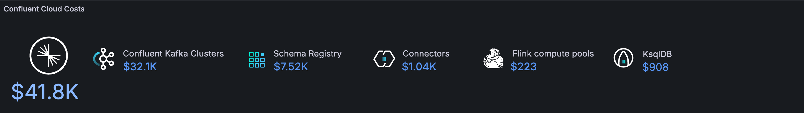
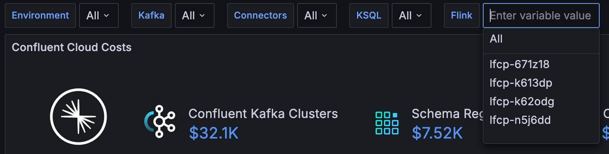
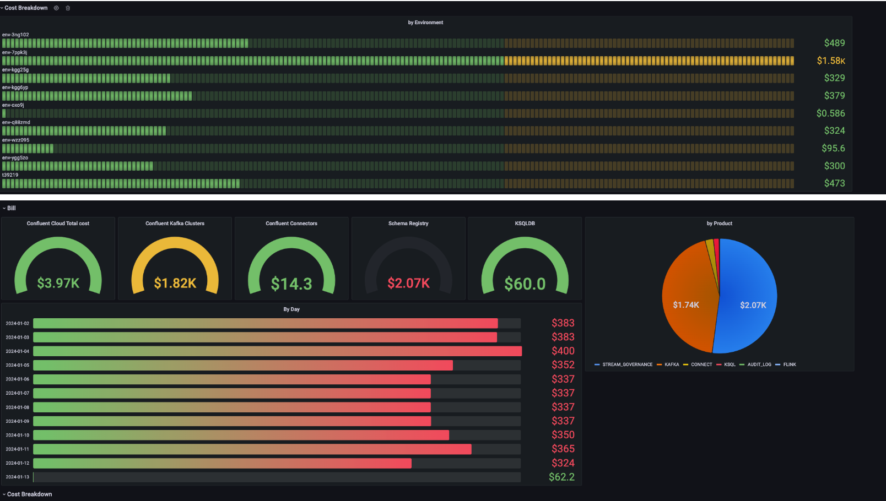
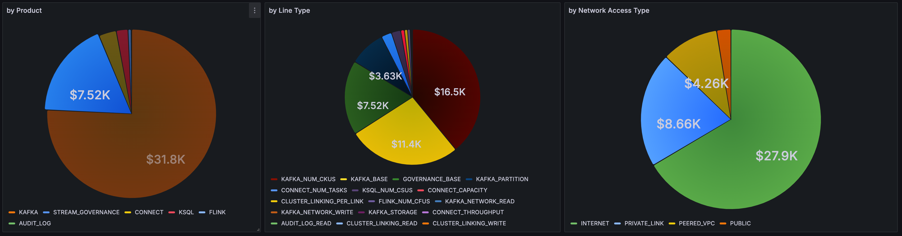
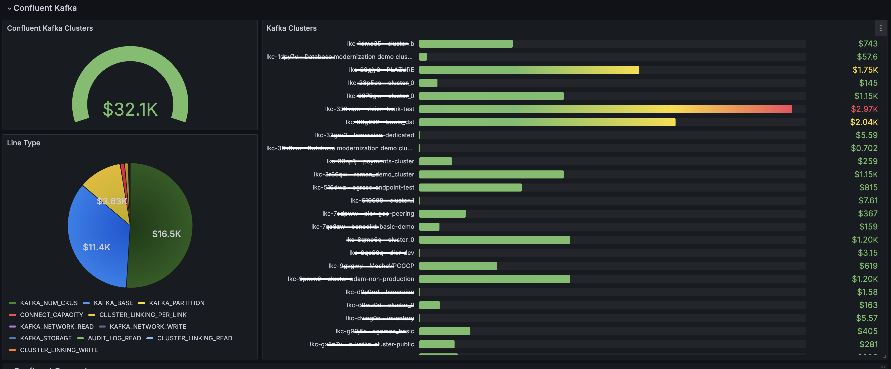

# Prometheus Grafana Integration with Confluent CCloud metrics (/export) endpoint

* A Sample POC to showcase Prometheus & Grafana integration with [CCloud Metrics endpoint](https://docs.confluent.io/cloud/current/monitoring/metrics-api.html#)
* Grafana configured with Prometheus as a Datasource for  Dashboard construction.
* Prometheus Scrape config - scrapes metrics from CCloud Metrics endpoint.

## NOTE

* This demo depends on a Confluent Cloud instance available for you and you should be able to create an API Key and plugin that api key to the correct location (mentioned below). The utility could scrape the following:
  1) One or many Kafka cluster.
  2) One or many fully managed Connectors running on Confluent cloud.
  3) One or many fully managed ksqlDB cluster running on Confluent cloud.
  4) One or many Schema Registry.

## Confluent Cloud Cost Exporter

This project integrates Confluent Cloud Cost information with Prometheus. It uses current month to query the cost information from Confluent Cloud and expose it as Prometheus metrics.

* [Confluent Cloud Costs API](https://docs.confluent.io/cloud/current/billing/overview.html) provides costs for Confluent Cloud resources.

[Confluent Costs API considerations](https://docs.confluent.io/cloud/current/billing/overview.html#retrieve-costs-for-a-range-of-dates):

* Cost data can take up to *72* hours to become available
* Start date can reach a maximum of one year into the past
* One month is the maximum window between start and end dates.

[More info](https://github.com/mcolomerc/confluent-cloud-cost-exporter)

Confluent Cloud Costs Grafana Dashboard:



* Filters by resource: Environment, Kafka Cluster, Connectors, ksqlDB and Flink Compute Pools. 



* Breakdown of costs by day  
  


* Breakdown of costs by product, line type and network access type.
  


* Breakdown of costs by resource:



## Confluent Cloud CDC Pipeline Latency dashboard

Provides an approximate, metrics-only view of end-to-end latency for a fully-managed CDC source connector → Kafka topics → fully-managed sink connector pipeline, built entirely from Confluent Cloud Metrics API data, along with per-table backlog and connector health.

### How the estimate is built

| Term | Metric / Source | Description |
|---|---|---|
| Source CDC lag | `<type>_cdc_source_connector_lag_milliseconds` | Worst value across the selected source connectors (and their tasks, where the metric has a `task` label). Anchored on each event's source commit timestamp, so database-side capture delay is included for events that flow. |
| Kafka queue time | `records_lag_max` (fetch lag) ÷ sink consume rate | Worst partition of each selected sink connector; ∞ ("stalled") when behind with no consumption. |
| Sink put-batch time | `sink_task_put_batch_avg_time_milliseconds` | Worst task of the selected sink connectors. |
| **Estimated latency** | **Sum of the three terms** | Approximate end-to-end latency from source database commit to target database write. |
| Committed-offset queue time (shown separately) | Committed consumer lag ÷ smoothed consume rate | Worst currently-backlogged topic of the selected sink connectors. Not part of the sum; shown as its own stat and as a dashed reference line. Usually reads well above the fetch-based value; it is a reference, not a guaranteed bound. |

### How to read it

* The committed-offset queue time includes the sink's offset-commit interval. It can read one to two orders of magnitude above the actual latency at steady state and during short bursts, while fetch lag stays small. When the two diverge, the fetch-based value is the closer estimate. The "Committed vs fetch lag" stat flags the divergence.
* With no backlog, fetch lag is 0 and the estimate is source lag plus put-batch time only. The sink's own poll-and-write cycle has no metric, so at steady state the estimate can read somewhat below the actual latency.
* The headline is approximate and follows typical (median) latency rather than the slowest records. When a sink spreads its partitions over several tasks, fetch lag can stay small during a burst while individual records take several times longer than the headline shows.
* Pauses of a few seconds, such as a task restart, may not show at all: the metrics are per-minute aggregates, and a small backlog spread over many partitions barely moves fetch lag.
* `records_lag_max` is the sink's worst partition, connector-wide, and it is divided by the connector's total consume rate. With several backlogged partitions or topics the fetch-based value can therefore understate further — check the per-table view and the committed-offset queue time.
* Source lag compares each event's source timestamp with the connector's clock, so clock differences between the database and the connector shift it. It reflects the last processed event: it latches when the source is idle, and a fully stalled capture produces no events, so it shows as idle (watch source throughput).
* The sum composes worst-partition and worst-task values from per-minute aggregates; it is not one record's journey.
* Consumed rate (`sent_records`) has no consumer-group label, so other consumers of the same topics are included.
* For an exact measurement, carry the source commit timestamp into the target row and compare it with a write timestamp set by the target database.

### Data notes

* Counter-type metrics (`received_records`, `sent_records`, `received_bytes`, `request_count`, …) are exported as per-minute values, not cumulative counters, so the dashboard and rules never use `rate()`.
* Samples are timestamped a few minutes in the past (`honor_timestamps: true`), hence the recording rules divide by the number of one-minute buckets actually in the window and the stack runs Prometheus with `--query.lookback-delta=10m`.
* When the API stops emitting a series (for example `records_lag_max` while a sink is idle), the rules keep its last value for up to 10 minutes. After a backlog drains and the sink goes idle, the fetch-based queue time can therefore show a stale value, or briefly ∞, until that window passes.
* `consumer_lag_offsets` is exported per topic and consumer group only, so per-partition / per-member detail (for example a consumer-group member that has left after a rebalance) is not visible in this data.
* A managed sink connector's consumer group is `connect-<connector id>`.
* The internal-topic filter excludes `_*`, `dbhistory.*`, `connect-*`, `dlq-*`, and `*.schema-changes*`.

### Panels

* **Headline**: Top-level single-stat KPIs for estimated pipeline latency, source lag, Kafka queue time (fetch lag), sink put-batch time, the committed-offset queue time, and stacked latency terms over time.
* **Sanity check**: Comparison of estimated queue time against fetch lag (`records_lag_max`) and committed lag to identify offset-commit interval artifacts.
* **Per-table**: Breakdown of consumer lag and Kafka queue time by topic in tabular and time-series panels.
* **Source connector**: CDC source lag, throughput (`records/s` out), batch size (average and maximum), and snapshot state over time.
* **Sink connector**: Sink put-batch time (average and maximum), throughput (`records/s` in), fetch lag (`records_lag_max`), batch size, and dead-letter-queue records.
* **Connector health**: Connector and task execution status (running, paused, failed) for selected connectors.

### Recording rules

The `assets/prometheus-rules/ccloud-cdc-latency.rules.yml` file defines the following precomputed series:
* `ccloud_cdc:kafka_buckets:count10m`: Number of one-minute scrape buckets in the 10m window per Kafka cluster.
* `ccloud_cdc:topic_produced_records:rate10m`: 10-minute smoothed produce rate (records/s) per topic.
* `ccloud_cdc:topic_consumed_records:rate10m`: 10-minute smoothed consume rate (records/s) per topic across all consumer groups.
* `ccloud_cdc:sink_topic_lag_offsets`: Committed consumer offset lag per topic mapped to sink connector IDs.
* `ccloud_cdc:sink_topic_queue_seconds`: Kafka queue time (seconds) per topic calculated as committed lag divided by consumed rate.
* `ccloud_cdc:sink_queue_seconds:max`: Worst topic queue time across backlogged topics per sink connector (+Inf if stalled).
* `ccloud_cdc:source_lag_ms:max`: Worst CDC source lag (ms) across tasks and supported source types.
* `ccloud_cdc:sink_put_batch_ms:max`: Worst task average put-batch time (ms) per sink connector.
* `ccloud_cdc:connector_buckets:count10m`: Number of one-minute scrape buckets in the 10m window per connector.
* `ccloud_cdc:connector_records:rate10m`: 10-minute smoothed connector throughput (records/s) with `direction` label (`out` for source, `in` for sink).
* `ccloud_cdc:sink_fetch_lag_records`: Sink `records_lag_max` (records the consumer is behind on its worst partition) per sink connector.
* `ccloud_cdc:sink_fetch_queue_seconds`: Kafka queue time (seconds) per sink as fetch lag divided by sink consume rate; 0 when not behind, +Inf when behind and consuming nothing.

Recording rules load automatically in this stack. With your own Prometheus, add the rules file to `rule_files` and run Prometheus with `--query.lookback-delta=10m` (or more): the rules read gauges with `last_over_time`, but several dashboard panels query raw gauges directly. The longer lookback applies to every dashboard on that Prometheus.

### Variables and configuration

* **Variables**: `kafka_id`, `source` (source connector ID `lcc-…`), and `sink` (sink connector ID `lcc-…`).
* **Connector scraping**: Add source and sink connector IDs to `CCLOUD_CONNECT_LCC_IDS` in `utils/env_variables.env` so they are scraped.
* **Supported CDC source connector types**: SQL Server, PostgreSQL, MySQL, Oracle, DynamoDB, MongoDB.

## How to run

### Step 1

```sh
git clone https://github.com/confluentinc/jmx-monitoring-stacks
cd jmx-monitoring-stacks/ccloud-prometheus-grafana
```

### Step 2

You will need to find some details from your CCloud Environments and feed it in this step. Please keep the following handy:

* API/Key Secret
* Inventory Information from your CCloud instance:
  * Kafka Cluster (lkc) IDs
  * ksqlDB Cluster (lksqlc) IDs
  * Connect Cluster (lcc) IDs
  * Schema Registry (lsrc) IDs

Now edit the file `./ccloud-prometheus-grafana/utils/env_variables.env` and add the above information in the respective columns:

* Update CCloud `CONFLUENT_CLOUD_API_KEY` and `CONFLUENT_CLOUD_API_SECRET` ( Note: Resource type= cloud Api-Key)
* Update `CCLOUD_KAFKA_LKC_ID` accepts single or multiple kafka clusters as comma-separated-string lkc-XXXX values
  * e.g "lkc-XXXX, lkc-yyyy" or for single cluster "lkc-xxxx"
* Update `CCLOUD_CONNECT_LCC_IDS` accepts single or multiple connect clusters as comma-separated-string lcc-XXXX values
  * e.g "lcc-XXXX, lcc-yyyy" or for single cluster "lcc-xxxx"
* Update `CCLOUD_KSQL_LKSQLC_IDS` accepts single or multiple ksqlDB clusters as comma-separated-string lksqlc-XXXX values
  * e.g "lksqlc-XXXX, lksqlc-yyyy" or for single cluster "lksqlc-xxxx"
* Update `CCLOUD_SR_LSRC_IDS` accepts single or multiple Schema Registry instances as comma-separated-string lsrc-XXXX values
  * e.g "lsrc-XXXX, lsrc-yyyy" or for single instance "lsrc-xxxx"

### Step 3

* Start the CCloud export demo

```sh
./start.sh
```

### Step 4 ( select dashboard )

* Open [Grafana_Endpoint](http://localhost:3000)
  * userid: admin
  * password: password
* Select Option to Browse Dashboards
* Open Confluent Cloud Dashboard or Confluent Cloud Cost dashboard.

### Step 5

* Stop the demo
  
```sh
./stop.sh
```

## Additional Links

* [Confluent Cloud - Monitoring/Metrics api](https://docs.confluent.io/cloud/current/monitoring/metrics-api.html)
* [Confluent Cloud Costs API](https://docs.confluent.io/cloud/current/billing/overview.html)